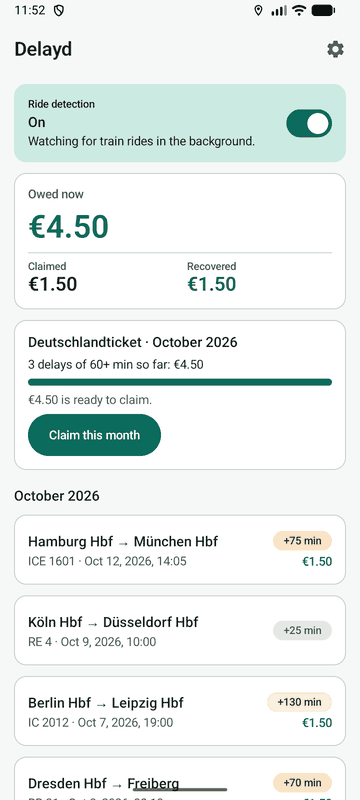
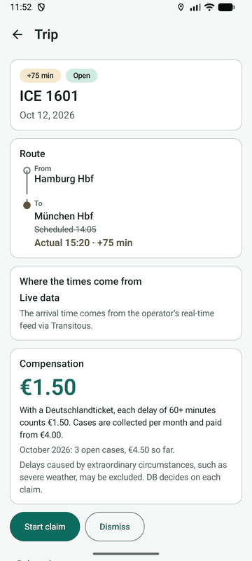
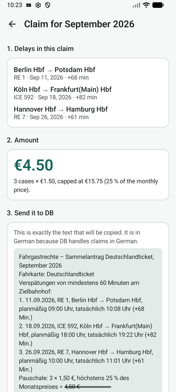
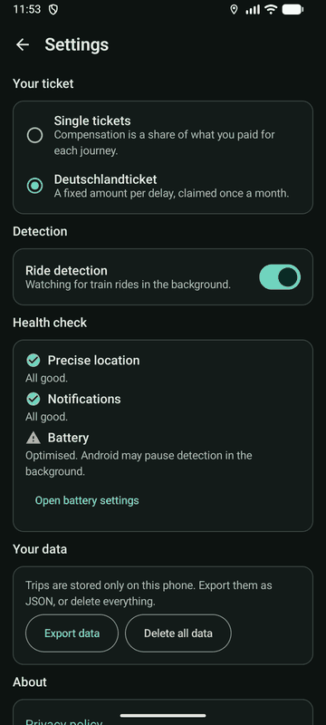

# Delayd

[](https://github.com/erdem61/delayd/actions/workflows/ci.yml)
[](LICENSE)


**Your train was late. Your money comes back without you doing anything.**

In Germany, a train arriving 60+ minutes late gets you 25 % of the fare back, and 120+ minutes gets you 50 %. With a Deutschlandticket you get 1.50 € per case. Most people never claim. Delayd notices your train rides by itself, checks them against live data and tells you when you're owed money, then prepares the claim.

Free and open source. No accounts, no ads, no analytics, no Google Play Services, no backend. Your location stays on your phone.

## Screenshots

| Home | Trip detail | Monthly claim | Settings |
|---|---|---|---|
|  |  |  |  |

## How it works

```
GPS / network fixes ──► TripDetector ──► Ride(start, end) ──► Transitous ──► Trip(train, delay) ──► Compensation
 (duty-cycled)          speed state       station to           departures at start,    stored on device,     DB rules,
                        machine           station              matched by arrival      notification          claim text
```

| Mobile computing topic | Where |
|---|---|
| Sensing and context: is the phone riding a train? | [`TripDetector.kt`](app/src/main/java/app/delayd/TripDetector.kt) |
| Energy: network fixes every 60 s when idle, GPS every 10 s only while moving | [`TrackingService.kt`](app/src/main/java/app/delayd/TrackingService.kt) |
| Matching a ride to a real train with live delay data | [`Transitous.kt`](app/src/main/java/app/delayd/Transitous.kt) |
| Phone as witness: when there's no live data, the measured arrival is used | `Transitous.match` |
| Privacy: location history stays on the device, the API only sees one station query | whole app |
| Domain rules: thresholds, 4 € minimum, Deutschlandticket cap | [`Compensation.kt`](app/src/main/java/app/delayd/Compensation.kt) |

Kotlin, Jetpack Compose, Material 3, platform `LocationManager`. Single `app` module, minSdk 26.

## Privacy

- Location is read and processed on the device only. No location history is uploaded.
- The only network request goes to `api.transitous.org` after a ride: the coordinate where the ride started (about a 500 m search radius) and the time.
- No accounts, analytics, crash reporting, ads or third-party SDKs.
- Export and delete your data in the app.

Full text: [Privacy policy](docs/privacy-policy.md) (EN + DE).

## Build & test

Requires JDK 17 and the Android SDK (or Android Studio).

```bash
./gradlew testDebugUnitTest   # detector, matching on a real API response, compensation rules
./gradlew lintDebug
./gradlew installDebug
./gradlew assembleRelease     # signed with the DEBUG key unless a release keystore is configured (local smoke test only)
```

Release signing, versioning and publishing: [docs/RELEASE.md](docs/RELEASE.md). Contributing: [CONTRIBUTING.md](CONTRIBUTING.md).

**Demo without riding a train:** the Android emulator can play back a GPX route (*Extended controls → Location → Routes*). The unit tests use a real Berlin Hbf departure board ([fixture](app/src/test/resources/departures-berlin-hbf.json)).

## Data credits

Train data comes from [Transitous](https://transitous.org) (MOTIS, open European transit data incl. realtime), see the [list of sources](https://transitous.org/sources/). Map and place data © [OpenStreetMap contributors](https://www.openstreetmap.org/copyright). The Transitous API is for open-source, non-commercial use only. A commercial version would self-host MOTIS or use the DB API Marketplace, and only `Transitous.kt` changes.

## Known limits

- Germany only. Delayd prepares your claim, it does not file it: DB's claim form needs a login.
- Underground stations without GPS can blur the arrival time.
- Since June 2023, delays caused by extraordinary circumstances (storms, strikes by third parties) may not be compensated.
- See the [CHANGELOG](CHANGELOG.md) for what each release covers.

## Roadmap

- [ ] Manual add when detection missed a ride (station and train search)
- [ ] Ticket QR scan for the fare
- [ ] Other countries: AT (ÖBB), CH, NL, IT

## Disclaimer

Delayd is an independent project and is not affiliated with Deutsche Bahn AG. Compensation amounts are estimates; the railway company decides on every claim.

## License

[MIT](LICENSE) © 2026 erdem61
